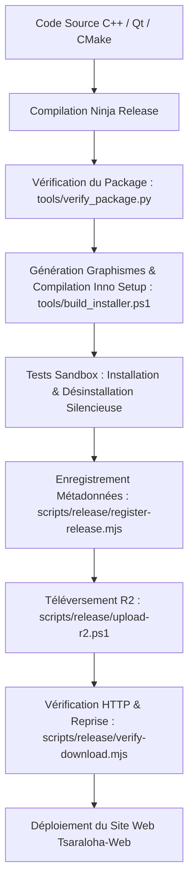

# Procédure de Publication Officielle de TSA (Release Workflow)

Ce guide décrit l'ensemble du cycle de publication d'une nouvelle version de **Tsaraloha Structural Analysis (TSA)**, de la compilation en production jusqu'à la mise en ligne des installateurs Windows et des métadonnées sur le site officiel.

---

## Vue d'ensemble du pipeline



---

## Étape 1 : Compilation et Déploiement Local du Logiciel (Dépôt `TSA`)

Dans le répertoire du logiciel TSA (`d:\Tsaraloha Platforme\TSA`) :

1. **Génération et compilation de la configuration Release** :
   ```powershell
   cmake --preset ninja-release
   cmake --build --preset ninja-release --target TSA
   ```
2. **Déploiement des dépendances redistribuables** :
   ```powershell
   cmake --build --preset ninja-release --target deploy
   ```
   Cette étape exécute `windeployqt`, copie les DLLs OpenCASCADE 8.0.1, OpenSees 3.8.0, Gmsh 4.15.2, IfcOpenShell 0.9.0, Fem3D et les runtimes Visual C++.

---

## Étape 2 : Construction et Validation de l'Installateur Windows

Exécutez le script d'automatisation officiel :
```powershell
powershell -ExecutionPolicy Bypass -File tools/build_installer.ps1 -OutputDir "build-ninja-release/dist"
```

Ce script effectue automatiquement :
- La vérification d'intégrité de l'arborescence binaire (`tools/verify_package.py`).
- La génération des bannières graphiques BMP aux couleurs officielles de Tsaraloha (`tools/generate_installer_graphics.py`).
- La compilation de l'installateur autonome `TSA-<version>-windows-x64-setup.exe` avec Inno Setup 6 (`ISCC.exe`).
- Le calcul de la taille exacte en octets et de l'empreinte cryptographique SHA-256.
- Le test réel d'installation et de désinstallation en environnement bac à sable temporaire (`/VERYSILENT /SUPPRESSMSGBOXES`).

---

## Étape 3 : Enregistrement des Métadonnées Directes (Dépôt `Tsaraloha-Web`)

Pour que le site web officiel référence immédiatement le véritable package sans dépendre d'une publication GitHub :

```powershell
node scripts/release/register-release.mjs "..\TSA\build-ninja-release\dist\TSA-0.1.0-windows-x64-setup.exe" --channel stable
```

Ce script :
- Calcule l'empreinte SHA-256 réelle du binaire sur disque.
- Enregistre la taille exacte et le lien direct HTTPS dans `src/config/releases-direct.json`.
- Met à jour les métadonnées de version, de système et de date.

---

## Étape 4 : Téléversement vers le Stockage Haute Disponibilité (Cloudflare R2)

Les binaires d'installation (~66.5 Mo à 1 Go+) sont hébergés sur Cloudflare R2 pour offrir des téléchargements directs, rapides et sans frais de bande passante (zéro coût egress).

Pour tester à blanc sans téléversement :
```powershell
powershell -ExecutionPolicy Bypass -File scripts/release/upload-r2.ps1 -FilePath "..\TSA\build-ninja-release\dist\TSA-0.1.0-windows-x64-setup.exe" -DryRun
```

Pour effectuer le téléversement effectif :
```powershell
# Avec AWS CLI (compatible S3 / R2) :
powershell -ExecutionPolicy Bypass -File scripts/release/upload-r2.ps1 -FilePath "..\TSA\build-ninja-release\dist\TSA-0.1.0-windows-x64-setup.exe"

# Ou avec Cloudflare Wrangler CLI :
wrangler r2 object put "tsa-downloads/releases/TSA-0.1.0-windows-x64-setup.exe" --file "..\TSA\build-ninja-release\dist\TSA-0.1.0-windows-x64-setup.exe"
wrangler r2 object put "tsa-downloads/releases/SHA256SUMS.txt" --file "C:\Users\...\Temp\SHA256SUMS.txt"
```

---

## Étape 5 : Vérification Réseau du Téléchargement

Avant de publier le site, vérifiez la disponibilité du binaire et le support de la reprise :
```powershell
node scripts/release/verify-download.mjs "https://downloads.tsaraloha.org/releases/TSA-0.1.0-windows-x64-setup.exe" --expected-size 69716178 --expected-sha256 81036c519627198715ee415c8528f579528fab8feadd9e81742805d5d2840e31
```

Le script confirme :
- Le statut HTTP 200 / 206 (Range Request / reprise après coupure).
- La correspondance exacte de la taille Content-Length.
- Les en-têtes de sécurité et de mise en cache.

---

## Étape 6 : Construction et Publication du Site

1. **Exécution des tests de non-régression** :
   ```powershell
   cmd /c "npm.cmd run test:releases"
   cmd /c "npm.cmd run test:docs"
   ```
2. **Construction du site statique** :
   ```powershell
   cmd /c "npm.cmd run build"
   ```
3. **Déploiement sur GitHub Pages / Cloudflare Pages** :
   Un simple `git push origin main` déclenche l'actualisation automatique du site officiel.
